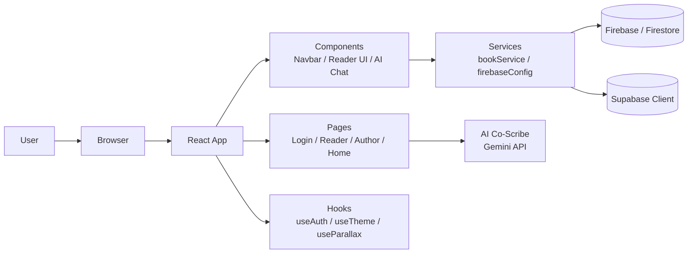
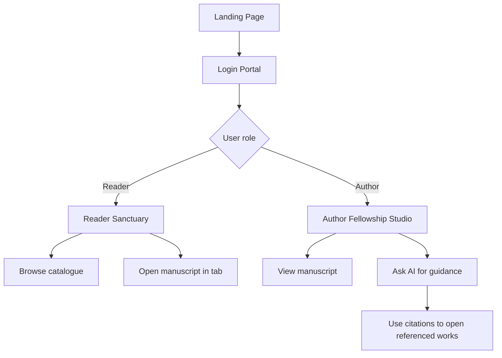

# Bhasha Library

Bhasha Library is a literary web application that brings Bengali literature, translation culture, and author workflows into a single immersive platform. It combines an archival reader experience, an author collaboration studio, and AI-enhanced manuscript research in a visually rich, heritage-inspired interface.

## Table of Contents

- [Overview](#overview)
- [Architecture](#architecture)
- [Core Features](#core-features)
- [User Experience Flow](#user-experience-flow)
- [Project Structure](#project-structure)
- [Prerequisites](#prerequisites)
- [Installation](#installation)
- [Environment Variables](#environment-variables)
- [Available Scripts](#available-scripts)
- [Development Notes](#development-notes)
- [License](#license)

## Overview

The project is a React + Vite frontend built for a literary ecosystem centered on Bengali works and scholarship. It includes:

- Reader Sanctuary for browsing, filtering, and reading literary works
- Author Fellowship Studio for manuscript exploration and AI-assisted writing research
- Role-based login flow for readers and authors
- Firebase-ready configuration for cloud storage and app services
- Artistic design inspired by Bengali Pattachitra and European manuscript traditions

## Architecture

The application follows a modular single-page architecture where route-level pages compose reusable UI components and service modules.



### Architectural Layers

1. Presentation Layer
   - Home, login, reader, and author pages
   - Navigation, tabs, cards, modals, and reading panels

2. State & Interaction Layer
   - Theme toggling, scroll tracking, page routing, and tab state
   - Local UI state for multi-tab reading and author workflows

3. Data & Integration Layer
   - Book metadata and manuscript records
   - Firebase configuration for cloud-backed services
   - Optional AI integration for writing/research guidance

## Core Features

### Reader Sanctuary
- Book catalogue with search and filters
- Multi-tab reading experience
- Decade and genre filtering
- Book detail browsing with chapter/page content

### Author Fellowship Studio
- Parallel manuscript workspace
- AI-powered literary assistant and source cross-references
- Manuscript publishing modal workflow
- Reading pane + assistant pane split layout

### User Experience
- Hash-based view navigation between home, login, reader, and author pages
- Theme switching between day and night modes
- Responsive, immersive reading interface

## User Experience Flow



## Project Structure

```text
Bhasha-Library/
├─ .env.example               # Environment variables template
├─ .firebaserc                # Firebase project aliases
├─ firebase.json              # Firebase hosting config
├─ firestore.indexes.json     # Firestore indexes
├─ firestore.rules           # Firestore security rules
├─ index.html                # App entry HTML
├─ package.json              # Scripts and dependencies
├─ vite.config.js            # Vite config
├─ public/                   # Static assets
├─ src/
│  ├─ assets/                # Art, logos, and static visuals
│  ├─ components/            # UI building blocks
│  ├─ hooks/                 # Theme, auth, and parallax hooks
│  ├─ pages/                 # Login, reader, author routes
│  ├─ services/              # Firebase and book data services
│  ├─ App.jsx                # Route selection and page composition
│  ├─ main.jsx               # App bootstrap
│  └─ styles/                # App styling and theming
├─ README.md
├─ storage.rules
└─ .gitignore
```

## Prerequisites

Before running the app locally, make sure you have:

- Node.js 18+
- npm or another package manager
- Firebase project configuration (if you plan to enable cloud features)
- Google Gemini API key for the AI co-scribe features

## Installation

1. Clone the repository:

   ```bash
   git clone https://github.com/NiladritaGhosh01/Bhasha-Library.git
   cd Bhasha-Library
   ```

2. Install dependencies:

   ```bash
   npm install
   ```

3. Create your local environment file:

   ```bash
   cp .env.example .env
   ```

4. Update the values in `.env` with your Firebase and Gemini credentials.

5. Run the app in development mode:

   ```bash
   npm run dev
   ```

6. Build for production:

   ```bash
   npm run build
   ```

## Environment Variables

The application expects the following values in a `.env` file:

```env
VITE_FIREBASE_API_KEY=your_firebase_api_key_here
VITE_FIREBASE_AUTH_DOMAIN=your_project_id.firebaseapp.com
VITE_FIREBASE_PROJECT_ID=your_project_id
VITE_FIREBASE_STORAGE_BUCKET=your_project_id.firebasestorage.app
VITE_FIREBASE_MESSAGING_SENDER_ID=your_messaging_sender_id
VITE_FIREBASE_APP_ID=your_app_id
VITE_FIREBASE_MEASUREMENT_ID=your_measurement_id
VITE_GEMINI_API_KEY=your_gemini_api_key_here
```

A template is already provided in [.env.example](.env.example).

## Available Scripts

```bash
npm run dev      # Start the Vite development server
npm run build    # Create a production build
npm run preview  # Preview the production build locally
npm run lint     # Run ESLint checks
```

## Development Notes

- The app is front-end driven and is designed to work as a literary portal experience.
- Some features depend on proper Firebase or Gemini configuration being supplied via environment variables.
- The project is structured around modular UI pages and reusable components, which makes it relatively easy to extend with additional author tools, book metadata, or personalization features.
- Book data is partially managed through a service layer and can be expanded for deeper persistence integration.

## License

This repository does not currently include a license file. If you intend to distribute or publish the project, consider adding an appropriate open-source license such as MIT or Apache 2.0.
